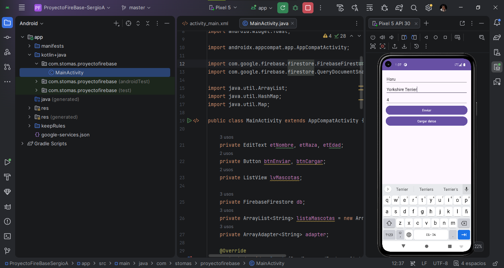
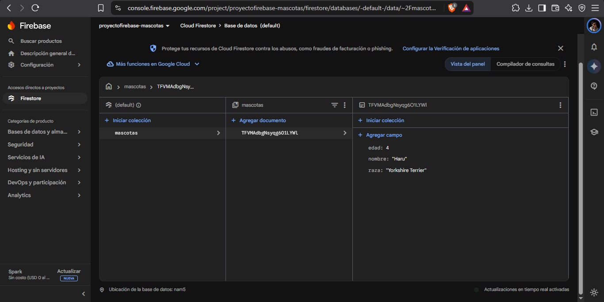

# ProyectoFirebase - Actividad 3.2

App Android en Java que envía datos de mascotas a Cloud Firestore y los muestra en una lista.

## Pruebas

### Ingreso de datos en la app

### Datos guardados en Firebase (Firestore)

## Tecnologías
- Java
- Android Studio
- Firebase Cloud Firestore
- Git y GitHub